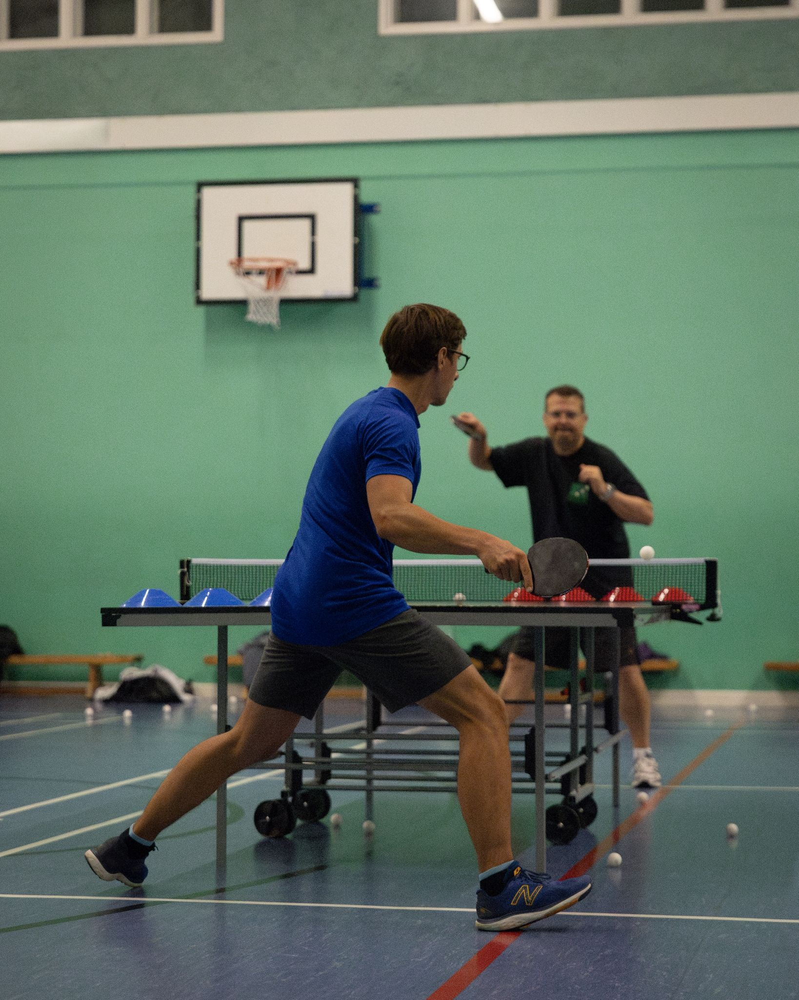

Our weekly "community sessions" are designed to be inclusive of everyone, whether playing leisurely or competitively. Our coach is available to provide advice.

We normally play on a Friday evenings from 5.30pm until 6.45pm (September to April) or from 6pm until 7.30pm (May to August). We sometimes break for half term but we play over the summer. There may be other small variations due to the varying availability of the hall. Please see the table below for the detail. Join the club's WhatsApp group (see the [contact us](contact.qmd) page) for regular reminders and latest updates.

We are open to all adults and motivated, supervised children aged 12 and over. New joiners are welcome to simply turn up at the session of their choice. We can supply all the equipment required, including lending bats. If you have a question before joining, please see the "contact us" page.

# Schedule of sessions

| Date | Venue | Time | To note |
| -------- | -------- | -------- | -------- |
| Friday 2 October 2026 | Sports Hall | 5.30pm-6.45pm |
| Friday 9 October 2026 | Sports Hall | 5.30pm-6.45pm |
| Friday 16 October 2026 | Sports Hall | 5.30pm-6.45pm |
| Friday 23 October 2026 | Sports Hall | 5.30pm-6.45pm |
| Friday 30 October 2026 | Sports Hall | 5.30pm-6.45pm |
| Friday 6 November 2026 | Sports Hall | 5.30pm-6.45pm |
| Friday 13 November 2026 | Sports Hall | 5.30pm-6.45pm |
| Friday 20 November 2026 | Sports Hall | 5.30pm-6.45pm |
| Friday 27 November 2026 | Sports Hall | 5.30pm-6.45pm |
| Friday 4 December 2026 | Sports Hall | 5.30pm-6.45pm |
| Friday 11 December 2026 | Sports Hall | 5.30pm-6.45pm |
| Friday 18 December 2026 | Sports Hall | 5.30pm-6.45pm |

Dates for the new year will be announced in due course and will follow a similar pattern.

# Fees, membership, and financial hardship policy

You can "pay as you go": we charge £6 per session for adults, and £4 for children under 16 accompanied by a playing adult. We accept card or cash on the door. 

Alternatively, you can opt for a "membership". Anyone with a membership enjoys unlimited access to our weekly community sessions for the duration of their membership.

| Membership period | Fee |
| -------- | ------- |
| September-December 2026 (4 months) | £65 |
| January-March 2027 (3 months) | £50 |
| April-June 2027 (3 months) | £50 |
| July-September 2027 (3 months) | £50 |
| September 2026-September 2027 (13 months) | £200 |

For memberships, we accept card payment and bank transfers. Please attend one of our sessions for a card payment or inquire for bank details. Those attending our sessions regularly are invited to fill this [form](https://docs.google.com/forms/d/e/1FAIpQLSeElvgpaoJbczteYr2RKx2OMc3yo-FwpwUwaxU0pzclbHrW2A/viewform?usp=sf_link).

The club is committed to making its activities accessible to everyone in the community. We recognise that financial hardship can be a barrier to participation, and we are committed to offering support to individuals and families who are experiencing financial difficulties. This policy sets out the principles and process for accessing free or subsidised services for those facing financial hardship or living on a low income: [Financial hardship policy](https://drive.google.com/file/d/1j7kxfWGU05WcrsIlVSeomTLbnt1OHwNj/view?usp=sharing).

{width=500}
